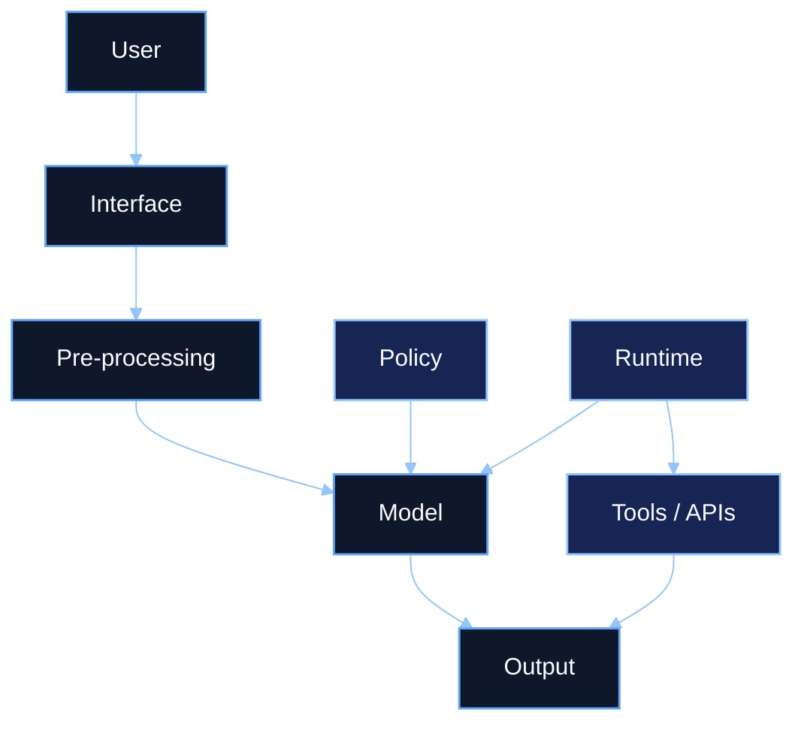
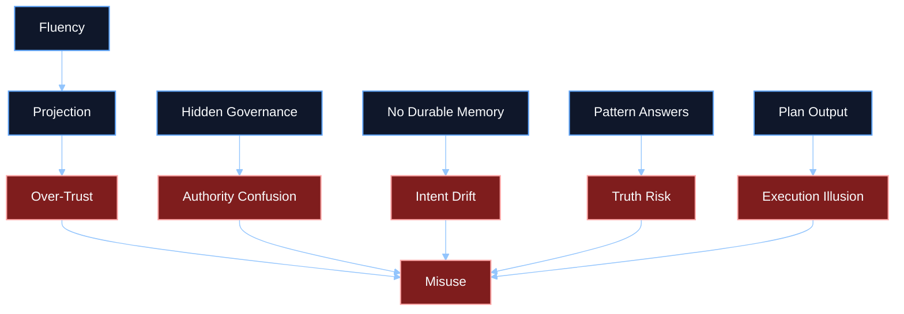

# Research Studies - ChatGPT Operating Model and Danger Analysis

## Library Classification

| Field | Value |
|------|-------|
| Category | `Research Studies` |
| Artifact type | Library companion |
| Source-of-truth | Governed KB article in `aios-governing-docs/reference/knowledge_base/articles/` |
| Retrieval goal | Give agents a short, high-signal map of how ChatGPT works, where authority actually lives, and what danger surfaces matter most |

## Executive Summary

This study analyzes ChatGPT as an operating stack rather than a single sovereign intelligence. The main finding is that users often interact with a unified conversational surface while the real system is split across interface, pre-processing, system prompt and policy, model inference, runtime orchestration, optional tools, and human governance.

For AI OS, the main lesson is that the largest risks are often architectural misunderstandings: treating inference like memory, plans like execution, fluency like truth, or the visible model layer like the final authority.

## Table of Contents

1. [Key Findings](#key-findings)
2. [Chapter 1 - The Real Stack](#chapter-1---the-real-stack)
3. [Chapter 2 - Intent and Signal Handling](#chapter-2---intent-and-signal-handling)
4. [Chapter 3 - Knowledge, Memory, and Truth Boundaries](#chapter-3---knowledge-memory-and-truth-boundaries)
5. [Chapter 4 - Planning Without Execution](#chapter-4---planning-without-execution)
6. [Chapter 5 - Danger Surfaces](#chapter-5---danger-surfaces)
7. [AI OS Relevance](#ai-os-relevance)

## Key Findings

- ChatGPT is a constrained reasoning engine inside a larger governed stack.
- Intent is inferred turn by turn unless an external system explicitly persists it.
- The model shapes answers using first-class and second-class signals, but these are transient modifiers rather than durable mission objects.
- Knowledge is pattern-based, not a clean internal record system.
- Planning output is not the same thing as execution capability.
- The most dangerous failure mode is often user over-trust caused by architectural misunderstanding.

## Chapter 1 - The Real Stack

### Summary

The source conversation repeatedly shows that ChatGPT works with and through multiple adjacent layers rather than acting alone.

### Core layers

| Layer | Role |
|------|------|
| User | Provides intent, pressure, and framing |
| Interface | Captures visible interaction |
| Pre-processing | Shapes, routes, and filters input |
| Model | Performs probabilistic inference |
| System prompt and policy | Constrain behavior |
| Runtime orchestration | Builds context and governs tools |
| Tools and APIs | Execute actions when enabled |
| Human governance | Defines and maintains control surfaces |

### Why this matters to AI OS

AI OS should disclose where authority actually lives instead of letting the user project all authority onto the visible conversational layer.

## Chapter 2 - Intent and Signal Handling

### Summary

The source archive frames ChatGPT as a system that infers intent, extracts signals, and merges those signals with constraints before producing a response.

### High-signal structure

- first-class signals: intent, task type, domain, depth, constraints, tone, epistemic standard, user model, conversation state, risk boundaries
- second-class signals: linguistic cues, skepticism, attention patterns, compression tolerance, ambiguity tolerance, interaction mode, trust calibration

### Why this matters to AI OS

If AI OS wants stable intent-to-outcome performance, it should not rely on hidden conversational inference alone. It should promote intent into explicit, persistent, reviewable objects.

## Chapter 3 - Knowledge, Memory, and Truth Boundaries

### Summary

The source conversation describes ChatGPT as a pattern-based knowledge synthesizer rather than a direct internal database.

### Boundary claims from the archive

- training data is the primary knowledge source
- system prompts shape behavior, not truth
- conversation context acts as temporary memory
- external tools can add retrieval or action when enabled
- the model does not inherently have durable cross-session memory or guaranteed up-to-date truth

### Why this matters to AI OS

The gap between fluent synthesis and grounded retrieval is a major risk surface. AI OS should keep retrieval provenance, knowledge boundaries, and truth claims explicit.

## Chapter 4 - Planning Without Execution

### Summary

The archive makes a sharp distinction between generating a plan and executing one. ChatGPT can produce structured steps, but it does not validate them against reality by itself.

### Core implication

- planning output can feel agentic
- no real-world execution guarantee exists without external systems
- real progress requires action, signal, and adjustment outside the model

### Why this matters to AI OS

AI OS should not mistake structured planning for controlled execution. Runtime evidence, handoff state, and outcome validation must live outside the model.

## Chapter 5 - Danger Surfaces

### Summary

The conversation archive surfaces several recurring risks:

1. authority illusion
2. memory illusion
3. knowledge illusion
4. execution illusion
5. intent drift
6. governance opacity
7. over-trust in conversational realism

### Why this matters to AI OS

AI OS should optimize for calibrated disclosure, grounded evidence, and explicit control surfaces instead of letting a fluent interface silently absorb all perceived authority.

## AI OS Relevance

This study supports five recurring AI OS design positions:

1. authority should be disclosed by layer, not implied by fluency
2. intent should be managed explicitly rather than inferred silently forever
3. grounded retrieval should be distinguishable from model synthesis
4. execution should be evidenced separately from planning
5. governance surfaces should be inspectable instead of hidden behind one assistant persona

## Canonical Source

The canonical long-form version of this study should live in the governed AI OS knowledge base. This library companion is optimized for retrieval, planning, and quick operator review.
