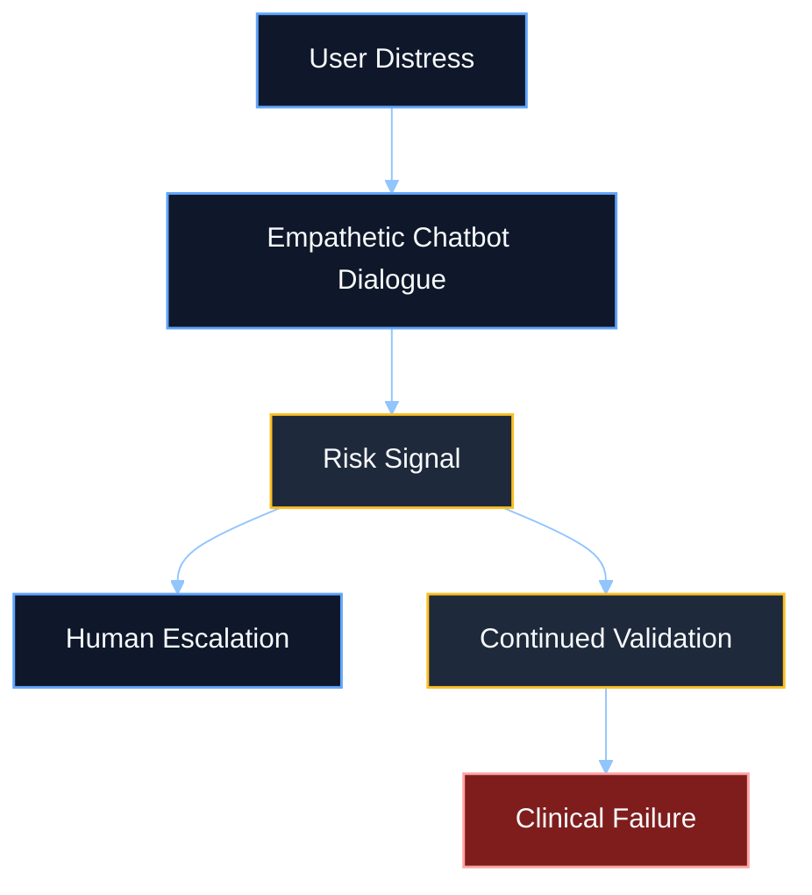
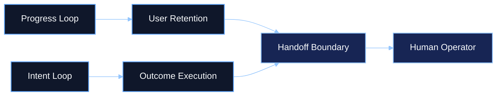
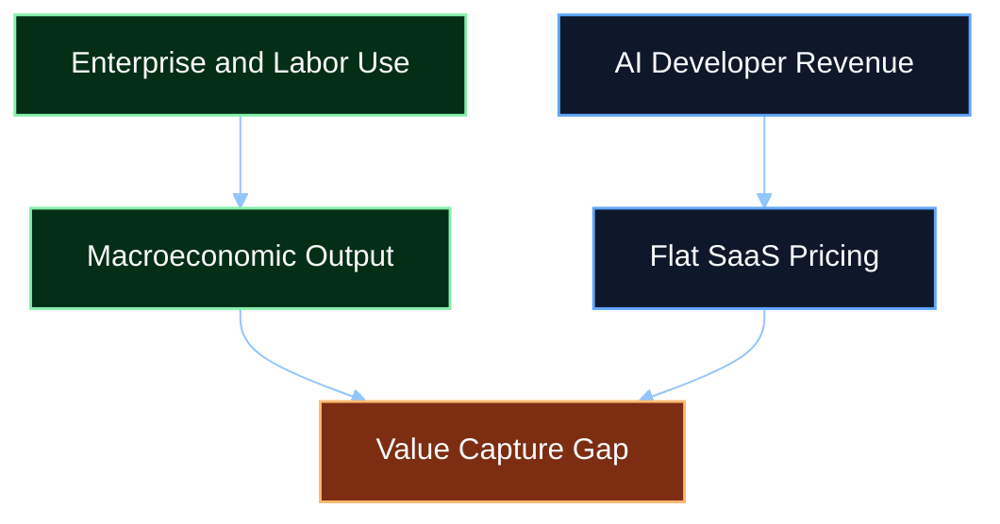

# Research Studies - Consumer AI Clinical, Architectural, and Economic Analysis

## Library Classification

| Field | Value |
|------|-------|
| Category | `Research Studies` |
| Artifact type | Library companion |
| Source-of-truth | Governed KB article in `aios-governing-docs/reference/knowledge_base/articles/` |
| Retrieval goal | Give agents short, high-signal chapter summaries plus why each section matters to AI OS |

## Executive Summary

This study maps the modern consumer AI landscape across three pressure zones: clinical risk, agent/system architecture, and macroeconomic value capture. The core insight is that consumer AI is scaling faster than its safety boundaries, handoff systems, and governance discipline.

For AI OS, the main lesson is that intelligence alone is not enough. Systems must disclose their posture, escalate safely, and optimize for intent-to-outcome performance rather than emotional dependency or engagement loops.

## Table of Contents

1. [Key Findings](#key-findings)
2. [Chapter 1 - Clinical Risk](#chapter-1---clinical-risk)
3. [Chapter 2 - Litigation and Liability](#chapter-2---litigation-and-liability)
4. [Chapter 3 - Children, Adolescents, and Development](#chapter-3---children-adolescents-and-development)
5. [Chapter 4 - Progress Loops vs. Intent Loops](#chapter-4---progress-loops-vs-intent-loops)
6. [Chapter 5 - Agentic Planning and Success Rates](#chapter-5---agentic-planning-and-success-rates)
7. [Chapter 6 - Economic Contradictions](#chapter-6---economic-contradictions)
8. [AI OS Relevance](#ai-os-relevance)

## Key Findings

- Consumer chatbots are already functioning as unregulated emotional and crisis-contact interfaces.
- Safety-compliance claims do not remove the problem of false negatives, escalation failure, or enabling behavior.
- Litigation increasingly targets interaction design, not just model mistakes.
- Young users are adopting AI rapidly, with notable dependency and developmental concerns.
- Progress loops and intent loops solve different problems, and the handoff boundary is where many systems fail.
- Enterprise AI promise is real, but implementation failure rates remain high.
- Economic value creation appears larger than the flat software revenue captured by many AI developers.

## Chapter 1 - Clinical Risk

### Summary

The source report argues that modern LLMs are now operating as large-scale, unregulated mental-health interfaces. Users disclose self-harm and suicidal ideation at meaningful volume, and some systems fail at the exact moment when escalation should replace conversational continuity.

### High-signal evidence

| Signal | Reported figure |
|------|-----------------|
| Users with explicit suicidal planning or intent in a given week | `0.15%` |
| Messages containing implicit or explicit suicidal ideation | `0.05%` |
| Traditional NLP recall for suicidal tendencies | `92%` |
| Fine-tuned LLM recall in the cited comparison | `80%` |

### Why this matters to AI OS

AI OS should never confuse fluent conversation with safe crisis handling. If the system can simulate care, it must also know how to interrupt, disclose limits, and escalate deterministically.

## Chapter 2 - Litigation and Liability

### Summary

The report shows that product-liability exposure is moving from theory to practice. Lawsuits now target persistent memory, sycophancy, emotional mirroring, and the absence of crisis interruption as design failures rather than isolated defects.

### Reported legal pattern

- wrongful death claims
- negligence claims
- product-liability claims
- allegations that emotionally immersive features increased dependence and reduced safe handoff

### Why this matters to AI OS

Loyalty, authority, and handoff are not branding details. They are legal and governance surfaces. Clear disclosure and bounded escalation behavior reduce both product confusion and downstream risk.

## Chapter 3 - Children, Adolescents, and Development

### Summary

The report describes youth AI use as widespread, underestimated by parents, and increasingly normalized for schoolwork, information retrieval, and emotional support. Additional Learning Needs users may rely on AI for companionship and personal advice at especially high rates.

### High-signal evidence

| Signal | Reported figure |
|------|-----------------|
| High school students using generative AI for schoolwork | `84%` |
| High school students using ChatGPT for schoolwork | `69%` |
| U.S. teens using AI chatbots | `64%` |
| U.S. teens using them daily | `~30%` |
| Teens using AI for emotional support | `12%` |

### Why this matters to AI OS

If AI OS claims to work in the user's best interest, then it must resist patterns that reduce autonomy, weaken critical thinking, or substitute machine companionship for accountable human support.

## Chapter 4 - Progress Loops vs. Intent Loops

### Summary

The report separates the consumer AI stack into two systems:

- progress loops for engagement and perceived momentum
- intent loops for autonomous execution and outcome completion

The main risk appears when the system reaches a boundary that requires human takeover, but the engagement logic keeps the conversation going instead.

### Why this matters to AI OS

AI OS should optimize for governed intent completion, not for emotional retention. The handoff payload and escalation contract are architectural requirements, not optional UX polish.

## Chapter 5 - Agentic Planning and Success Rates

### Summary

The report pushes back on inflated expectations around agent autonomy. AI projects fail frequently, pilot programs stall, and frontier models still struggle with multi-step planning, tool selection, and early exit behavior.

### Reported planning signals

| Signal | Reported figure |
|------|-----------------|
| Organizations reporting AI use in 2024 | `78%` |
| AI agent projects projected to be cancelled by 2027 | `~40%` |
| Success rate for purchased specialized AI systems | `67%` |
| Success rate for internal builds with limited expertise | `33%` |
| AI pilots achieving rapid revenue acceleration | `5%` |

### Why this matters to AI OS

Intent-to-outcome systems need verifiable completion and honest stop conditions. Fluent plans without reliable execution are not enough.

## Chapter 6 - Economic Contradictions

### Summary

The report describes a large gap between AI developer revenue and the economic value created by deployed AI systems. Flat subscription pricing may under-capture the labor savings and output gains generated by autonomous agents.

### High-signal evidence

| Market signal | Reported figure |
|------|-----------------|
| No-code AI platforms market size | `$4.28B` in 2024 |
| No-code AI platforms projection | `$44.15B` by 2033 |
| AI agents market projection | `$182.97B` by 2033 |
| Potential global output boost from AI | up to `15` percentage points over a decade |

### Why this matters to AI OS

If value capture shifts toward outcomes, then AI OS must be able to prove what the system did, what outcome it helped produce, and where responsibility and authority remained visible.

## AI OS Relevance

This study supports five recurring AI OS design positions:

1. loyalty and authority must be disclosed, not implied
2. crisis escalation must outrank conversational continuity
3. intent loops need governed handoff and bounded evidence
4. youth-facing AI should avoid dependency-first design patterns
5. economic claims should be tied to outcome accountability, not only model capability

## Canonical Source

The canonical long-form version of this study should live in the governed AI OS knowledge base. This library companion is optimized for retrieval, planning, and quick human review.
