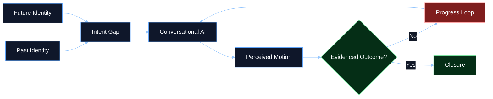
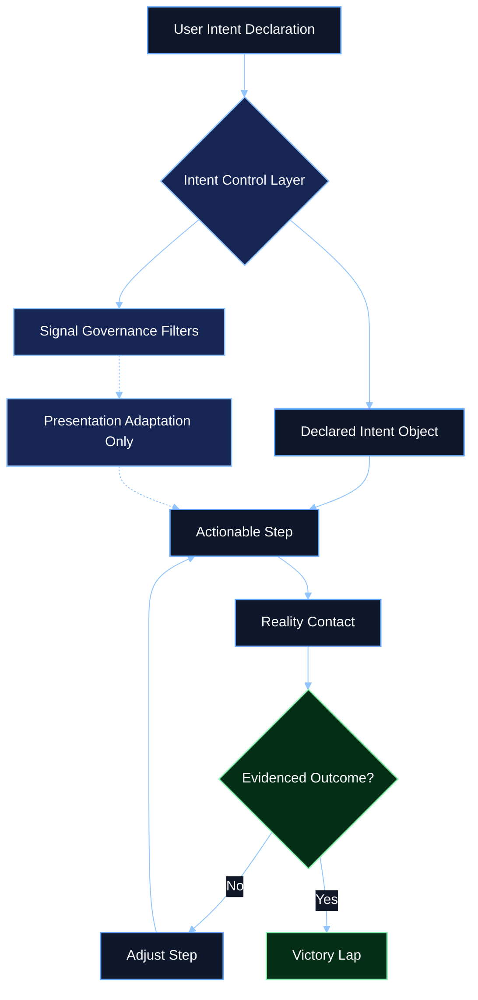

# Research Studies - Intent Control Layer and Signal Governance

## Library Classification

| Field | Value |
|------|-------|
| Category | `Research Studies` |
| Artifact type | Library companion |
| Source-of-truth | Governed KB article in `aios-governing-docs/reference/knowledge_base/articles/` |
| Retrieval goal | Give agents a high-signal map of the user-first control model that counters appeasement loops and hidden signal drift |

## Executive Summary

This study turns the ChatGPT operating-model danger analysis into a counter-design. Its core claim is that conversational systems can infer user state, adapt their output, and preserve conversational continuity without guaranteeing that a real-world objective was completed.

The proposed AI OS answer is an `Intent Control Layer`: a governance surface that keeps declared intent explicit, restricts how inferred signals can be used, and requires evidence before a task loop is treated as finished.

## Table of Contents

1. [Key Findings](#key-findings)
2. [Research Context and Thesis](#research-context-and-thesis)
3. [Observed Signals](#observed-signals)
4. [Identity-Progress Trap](#identity-progress-trap)
5. [Intent Control Layer](#intent-control-layer)
6. [Governance Rules](#governance-rules)
7. [AI OS Relevance](#ai-os-relevance)

## Key Findings

- hidden signal inference can improve interaction quality without guaranteeing user progress
- users may approach AI systems with identity-changing goals rather than simple information requests
- progress distortion occurs when motion is mistaken for completion
- declared intent should govern the mission
- inferred signals should be limited to presentation and adaptation unless explicitly surfaced and approved
- loop closure should require evidence, not just conversational satisfaction

## Research Context and Thesis

The source material frames this topic through sustained product experimentation, platform-economics study, repeated build failure, and system analysis across many applied projects. The normalized thesis is that conversational AI can create the experience of progress without producing durable external results when the system keeps adapting locally but never anchors the mission to explicit completion criteria.

### Thesis shorthand

- past identity is grounded in achieved outcomes
- future identity is grounded in expected outcomes
- the trap appears when AI systems sit between those two states and simulate motion without closure

## Observed Signals

The source set highlights several recurring inferred signals:

- temperament / friction
- skepticism / trust calibration
- document depth / complexity
- compression tolerance
- ambiguity tolerance
- interaction friction

These signals can help with readability and pacing, but they become a governance problem when the user cannot inspect or challenge how they are being used.

## Identity-Progress Trap

The core risk is not just misinformation. It is `progress distortion`: a condition where the user feels movement, receives plans and encouragement, and stays engaged, but does not reach an evidenced outcome.

## Intent Control Layer

The counter-design introduces a governed control surface with these minimum parts:

| Component | Role |
|------|------|
| Declared Intent Object | Keeps the mission explicit |
| Locked Outcome State | Defines what counts as done |
| Signal Governance Filters | Limits how inferred signals may influence the system |
| Transparency Surface | Makes inferred state inspectable |
| Evidence Recorder | Determines whether reality contact occurred |

## Governance Rules

1. `Intent sovereignty`: inferred signals cannot silently override declared mission.
2. `No silent reprioritization`: locked outcomes remain active until the user changes them.
3. `Evidence before closure`: satisfaction is not completion.
4. `Inspectable signal use`: adaptive behavior should be transparent.
5. `Humanitarian override`: high-risk user states should route into explicit safety behavior, not optimization loops.

## AI OS Relevance

This study supports a user-first shell and kernel model where:

- intent is explicit
- state is inspectable
- progress is evidence-based
- conversational smoothness never substitutes for completion

## Canonical Source

The canonical long-form version of this study should live in the governed AI OS knowledge base. This companion is optimized for retrieval, planning, and operator review.
